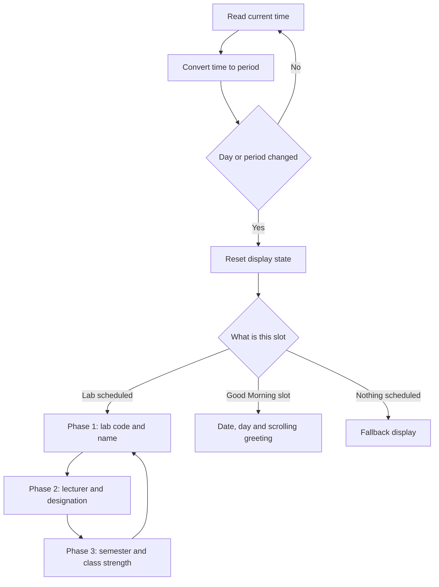

# Smart Digital Lab Display
A 3-strip LED display that tells you what's happening in the lab right now: which lab is running, who the lecturer is, and how many students are in the class. It changes on its own as the day goes by, so nobody has to update a notice board.

I built this in our Computer Engineering lab at Government Polytechnic Proddatur as part of the lab digitalization effort. The idea was simple: replace a static board with something that is always correct and also looks good.


## What it does

- Picks the correct lab automatically based on the day and the period
- Cycles through lab code, lab name, lecturer, designation and class strength
- Shows a "Good Morning" screen with today's date and day before classes begin
- Falls back to a default display when no lab is scheduled
- Gets the time over WiFi from the internet, so no RTC module is needed
- Also has an RTC (DS3231) version that works fully offline
- Schedule data is easy to change: labs, lecturers, strengths and timings can all be edited without touching the display logic
- Never blocks on `delay()` while running, so scrolling text stays smooth
- Prints debug logs over Serial, which made testing much easier

## Hardware

| Part | Quantity |
|---|---|
| ESP32 DevKit | 1 |
| MAX7219 FC16 4-in-1 LED matrix module | 3 |
| DS3231 RTC module (RTC version only) | 1 |

Each module has 4 matrices, so every strip is 32 x 8 pixels.

## Wiring

| Strip | DIN | CLK | CS |
|---|---|---|---|
| Strip 1 | 23 | 18 | 5 |
| Strip 2 | 19 | 16 | 4 |
| Strip 3 | 27 | 26 | 25 |

The DS3231 connects to the ESP32's default I2C pins (SDA and SCL).

## Libraries used

- MD_Parola
- MD_MAX72XX
- RTClib (RTC version)

Install them from the Arduino Library Manager.

## How it works

Every loop, the ESP32 reads the current time and turns it into a period number. It only does real work when the day or the period changes. At that moment it resets its state, looks up which lab (if any) belongs to that slot, and hands over to a small phase machine that rotates the content on the three strips.



The time source is either the DS3231 RTC or WiFi time, depending on the version you flash.

## Changing the schedule

All the lab details sit in one place at the top of the sketch, in simple `Lab` entries (code, name, lecturer, designation, semester). The mapping of which lab runs on which day and period is a single `switch` block in `loop()`. To use this in another lab or for a new semester, you only edit those two parts. The display logic stays the same.

## Folder structure

```
firmware/
  lab_display_rtc/     DS3231 RTC version
  lab_display_wifi/    WiFi time version
```

## Getting started

1. Wire the strips and (for the RTC version) the DS3231 as shown above
2. Install the libraries listed above
3. Open the sketch for the version you want
4. For the WiFi version, add your own WiFi name and password locally. Never commit them to the repo
5. Select **ESP32 Dev Module**, choose the right port and upload

## Things I want to add next

- A small web page to edit the timetable over WiFi
- Over-the-air firmware updates
- Automatic brightness using a light sensor

## Author

Surya, B.Tech CSE (AI and ML), G. Pulla Reddy Engineering College.
Diploma in Computer Engineering, Government Polytechnic Proddatur.
